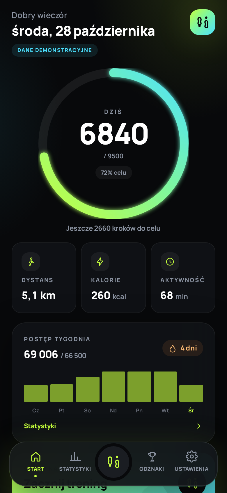
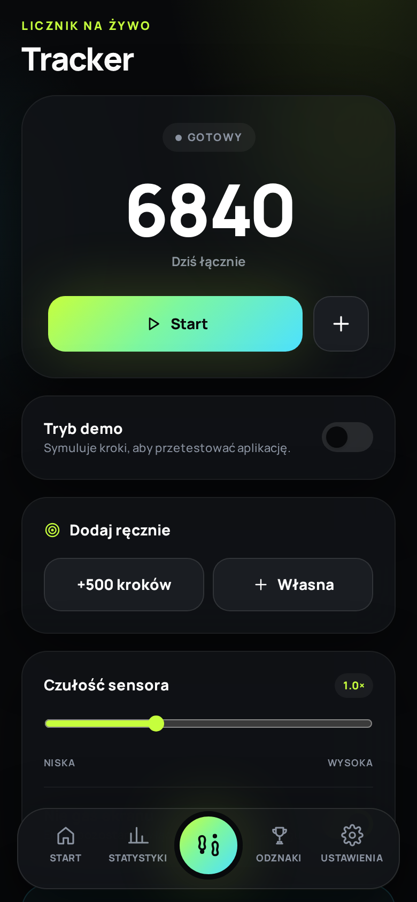
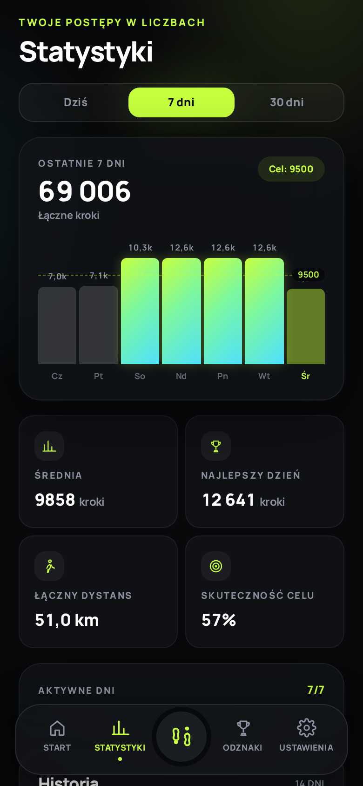
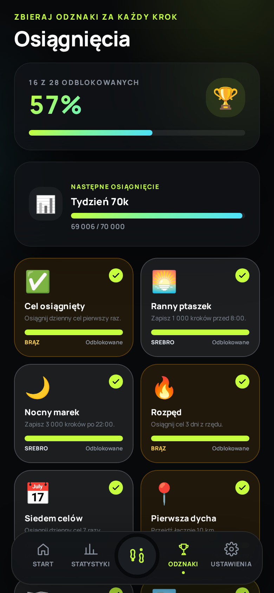

# Krokomierz 🏃‍♂️

Nowoczesny krokomierz w wersji **PWA** i **Android APK**. Ciemny, sportowy interfejs, cele wyliczane z profilu, statystyki, 28 osiągnięć i przypomnienia. Wszystkie dane zostają na urządzeniu — bez konta, chmury i reklam.

- 🌐 Strona i pobieranie: **https://krokomierz.multidev.top**
- 📱 Wersja PWA: **https://krokomierz.multidev.top/app/**
- 💾 APK: **https://krokomierz.multidev.top/download/krokomierz-1.0.0.apk?v=2**
- 💻 Repozytorium: **https://github.com/multicolor-rgb/krokomierz**

## Zrzuty ekranu

| Pulpit | Tracker | Statystyki | Osiągnięcia |
|---|---|---|---|
|  |  |  |  |

## Funkcje

| Funkcja | Opis |
|---|---|
| **Licznik kroków** | W APK natywny sensor `TYPE_STEP_COUNTER` + foreground service (liczy w tle). W przeglądarce akcelerometr (`DeviceMotion`) z filtrem i detekcją szczytów. |
| **Mądre cele** | Rekomendacja z wieku, wzrostu, wagi, płci, aktywności, BMI i celu. Automatyczna progresja do +20%. |
| **Statystyki** | Dzień / 7 dni / 30 dni, dystans, kalorie, aktywne minuty, rekordy, skuteczność celu, historia. |
| **Osiągnięcia** | 28 odznak: serie, rekordy, kamienie milowe (1 000 → 1 000 000 kroków), ranny ptaszek, nocny marek. |
| **Przypomnienia** | Wybór godziny i dni tygodnia. W APK natywne powiadomienia działają przy zamkniętej aplikacji. |
| **Prywatność** | IndexedDB / SharedPreferences, eksport i import JSON, pełny offline, zero kont. |
| **PL / EN** | Pełne tłumaczenie interfejsu, osiągnięć i strony internetowej. |

## Struktura repozytorium

```
krokomierz/
├── mobile/                  # aplikacja React + Capacitor
│   ├── src/                 # UI, logika, i18n, IndexedDB
│   ├── android/             # projekt Android (Java + natywny plugin)
│   ├── public/              # ikony PWA
│   └── scripts/             # generowanie ikon, zrzuty ekranu
├── landing/                 # strona internetowa PL/EN
├── scripts/
│   ├── build-apk.sh         # build + podpis + version.json
│   └── deploy.sh            # publikacja strony i PWA
├── download/                # APK, AAB, SHA-256, version.json
└── assets/                  # źródłowy logotyp SVG
```

## Wymagania

- Node.js 20+
- JDK 21 (lub 17)
- Android SDK: `platforms;android-35`, `build-tools;35.0.0`, `platform-tools`
- Do zrzutów ekranu: Playwright Chromium (opcjonalnie)

## Uruchomienie lokalne

```bash
# aplikacja
cd mobile
npm ci
npm run dev            # http://localhost:5173

# strona
cd landing
npm ci
npm run dev            # http://localhost:5174
```

Tryb demo (dane przykładowe, przydatne do zrzutów):

```
http://localhost:5173/?demo=1&screen=stats&lang=pl
```

## Budowa APK

Podpisany build wymaga pliku `mobile/android/keystore.properties`:

```properties
storeFile=/ścieżka/do/release.jks
storePassword=********
keyAlias=krokomierz
keyPassword=********
```

Następnie:

```bash
JAVA_HOME=/ścieżka/do/jdk \
ANDROID_HOME=/ścieżka/do/android-sdk \
./scripts/build-apk.sh
```

Wynik:

```
download/krokomierz-1.0.0.apk
download/krokomierz-1.0.0.aab
download/krokomierz-1.0.0.apk.sha256
download/version.json
```

### Podpisywanie

Klucz release **nigdy nie trafia do repozytorium**. Trzymaj go poza projektem i zrób kopię zapasową — bez niego nie da się wydać aktualizacji (utrata klucza = nowy pakiet/nowa instalacja). Do GitHub Actions dodaj sekrety:

| Sekret | Wartość |
|---|---|
| `KEYSTORE_BASE64` | `base64 -w0 release.jks` |
| `KEYSTORE_PASSWORD` | hasło magazynu |
| `KEY_ALIAS` | `krokomierz` |
| `KEY_PASSWORD` | hasło klucza |

## Wdrożenie strony

```bash
./scripts/deploy.sh
```

Skrypt buduje PWA (`base=/app/`) i stronę, a następnie publikuje:

- `/` — strona PL/EN,
- `/app/` — aplikacja PWA,
- `/download/` — APK, AAB, SHA-256, `version.json`.

Nginx (vhost `krokomierz.multidev.top`) serwuje katalog repozytorium. HTTPS zapewnia Cloudflare.

## Natywny licznik kroków (Android)

- `StepCounterPlugin` — uprawnienie `ACTIVITY_RECOGNITION`, start/stop usługi, odczyt dzisiejszych kroków, ręczne korekty.
- `StepService` — foreground service typu `health`, sensor `TYPE_STEP_COUNTER`, stałe powiadomienie z licznikiem.
- `StepStore` — baseline sensora, offset, obsługa nowego dnia i restartu telefonu.
- `BootReceiver` — wznawia liczenie po restarcie urządzenia.
- Powiadomienia — `@capacitor/local-notifications`, harmonogram dla wybranych dni tygodnia.

> Uwaga: Android 14+ może ograniczać start usługi z tła; liczenie wznawia się przy następnym otwarciu aplikacji.

## Ograniczenia wersji web

Przeglądarki nie mają dostępu do systemowego licznika kroków (HealthKit / Google Fit). W PWA liczenie działa, gdy aplikacja jest otwarta; na iOS wymagana jest zgoda na `DeviceMotion`. Pełne liczenie w tle zapewnia tylko APK.

## Licencja

[MIT](LICENSE) © 2026 multicolor-rgb
